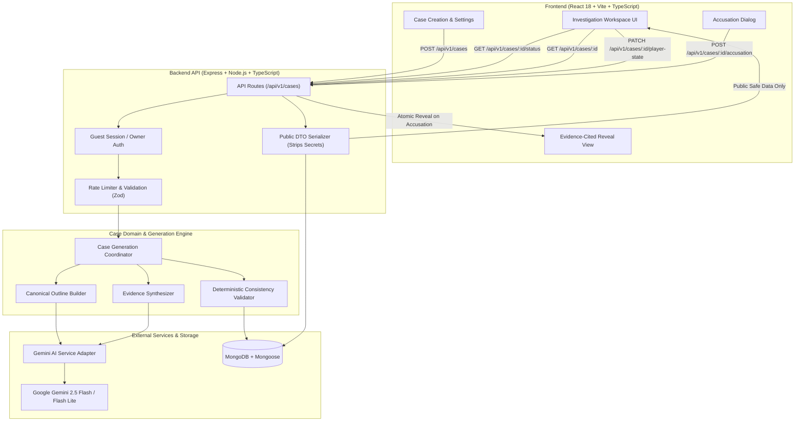

# Architecture.md — Application Architecture & Stack

> **Project:** AI Mystery Room  
> **Architecture Status:** Locked (SSOT per `AI_Mystery_Room_Spec.md`)  

---

## 1. High-Level Architecture & System Flow



---

## 2. Technology Stack

| Layer | Technology | Rationale |
|-------|------------|-----------|
| **Frontend** | React 18, Vite, TypeScript | Fast HMR, type safety, modular component architecture. |
| **Styling** | Tailwind CSS v3 / PostCSS | Utility-first, strict dark-mode-first detective palette, zero runtime overhead. |
| **Icons & UI Primitives** | Lucide React, Headless UI / Radix primitives | Accessible modals, tabs, dropdowns, and evocative detective iconography. |
| **Backend** | Node.js, Express, TypeScript | Lightweight, robust ecosystem, async pipeline coordination. |
| **Database & ODM** | MongoDB with Mongoose | Flexible document model for polymorphic evidence types and embedded player state. |
| **In-Memory / Dev DB**| `mongodb-memory-server` + Native URI support | Zero-dependency local setup when local MongoDB daemon is not running. |
| **AI Provider** | Google Gen AI SDK (`@google/genai`) | Official Google Gemini SDK with structured JSON schemas and low latency. |
| **Validation** | Zod | Runtime request validation and AI structured output parsing. |
| **Testing** | Vitest, Supertest, Playwright | Fast unit tests, integration API testing, and browser E2E verification. |
| **Package Management**| npm Workspaces (`apps/web`, `apps/api`, `packages/shared`)| Monorepo structure for code reuse and boundary enforcement. |

---

## 3. Directory & Monorepo Structure

```text
ai-mystery-room/
├── apps/
│   ├── web/                         # React Frontend (Vite + TypeScript + Tailwind)
│   │   ├── src/
│   │   │   ├── app/                 # App root and router configuration
│   │   │   ├── components/          # Reusable UI primitives (AppShell, Badge, Modal, etc.)
│   │   │   ├── features/            # Feature-sliced modules
│   │   │   │   ├── case-creation/   # Scenario input & generation spinner
│   │   │   │   ├── investigation/   # Workspace 3-column desk layout
│   │   │   │   ├── evidence/        # Specialized viewers (Chat, Camera, Doc, Witness)
│   │   │   │   ├── accusation/      # Accusation confirmation dialog
│   │   │   │   └── case-history/    # My Cases dashboard & history
│   │   │   ├── hooks/               # Custom hooks (useCase, usePollStatus, useNotes)
│   │   │   ├── lib/                 # API client & local session storage
│   │   │   └── types/               # Frontend-safe types
│   │   ├── tests/                   # Vitest frontend component tests
│   │   ├── index.html
│   │   ├── vite.config.ts
│   │   └── package.json
│   │
│   └── api/                         # Express Backend (TypeScript)
│       ├── src/
│       │   ├── config/              # Env loading & startup validation
│       │   ├── middleware/          # Session auth, error handler, rate limiters
│       │   ├── routes/              # Express route definitions (/api/v1)
│       │   ├── controllers/         # Case, status, accusation controllers
│       │   ├── services/
│       │   │   ├── ai/              # Gemini SDK adapter with structured prompts
│       │   │   ├── case-generation/ # Multi-stage pipeline coordinator
│       │   │   ├── mystery-validation/ # Deterministic consistency engine
│       │   │   └── evidence-assets/ # Simulated card & image asset generator
│       │   ├── models/              # Mongoose schemas (MysteryCase)
│       │   ├── schemas/             # Zod input & AI response schemas
│       │   ├── utils/               # Logger, DTO serializers
│       │   ├── app.ts               # Express application setup
│       │   └── server.ts            # Server entrypoint with DB lifecycle
│       ├── tests/                   # Supertest API integration tests
│       └── package.json
│
├── packages/
│   └── shared/                      # Shared types, constants, and contracts
│       ├── src/
│       │   ├── constants/           # Enums (Genres, Difficulties, EvidenceTypes)
│       │   ├── schemas/             # Client/server shared Zod schemas
│       │   └── types/               # Public DTO types (strictly no private solution types)
│       └── package.json
│
├── docs/
│   ├── SPEC.md                      # Copy of authoritative spec
│   └── DECISIONS.md                 # Architecture Decision Records (ADRs)
├── e2e/                             # Playwright end-to-end tests
├── PRD.md
├── Architecture.md
├── Rules.md
├── Phases.md
├── Design.md
├── Memory.md
├── package.json                     # Monorepo root workspaces config
└── .env.example
```

---

## 4. Data Models & Schemas

### MysteryCase (Mongoose Collection: `mystery_cases`)
- **Root Fields:**
  - `ownerId`: String (Indexed) — Server-issued guest session UUID or authenticated user ID.
  - `title`: String — Evocative case title.
  - `scenarioSeed`: String — Original user input prompt.
  - `genre`: String enum (`classic_mystery`, `locked_room`, etc.).
  - `difficulty`: String enum (`easy`, `medium`, `hard`).
  - `setting`: String — Physical and atmospheric environment.
  - `status`: String enum (`queued`, `generating_outline`, `generating_evidence`, `validating`, `ready`, `failed`, `completed`).
- **`publicCase` Object (Visible to Player before and after accusation):**
  - `premise`: Narrative hook.
  - `incidentSummary`: Known initial facts.
  - `incidentTime`: ISO 8601 string.
  - `briefing`: Senior investigator briefing memo.
  - `suspects`: Array of `PublicSuspect` (ID, name, role, bio, relationship, stated alibi, public motive).
  - `evidence`: Array of `PublicEvidence` (ID, type, title, description, timestamp, sourceLabel, reliability, content, asset, fictionalLabel).
  - `timeline`: Array of `PublicTimelineEvent` (time, description, verified status, related evidence/suspect IDs).
- **`privateSolution` Object (SERVER-ONLY — Never serialized in public API endpoints):**
  - `culpritSuspectId`: String.
  - `motive`: True underlying motive.
  - `method`: Precise mechanics of the crime/incident.
  - `canonicalTimeline`: Array of true chronological occurrences.
  - `solutionExplanation`: Grand reveal narrative.
  - `evidenceReasoning`: Map of evidence IDs with reasons and effects (`supports_culprit`, `weakens_alternative`, `red_herring`, `context`).
- **`playerState` Object:**
  - `markedEvidenceIds`: String array.
  - `notes`: Array of investigator notes (timestamp, text, optional evidenceId).
  - `accusation`: { suspectId, submittedAt, correct } (set upon final submission).

---

## 5. Security & Boundary Architecture

1. **Zero Answer Leakage:**
   - The backend controller maps cases through a strict `toPublicCaseDTO()` serializer.
   - Database queries for public cases use Mongoose projection (`-privateSolution`) or explicit DTO stripping.
   - Solution fields are only read and merged when an accusation transitions the case to `completed`.
2. **Session & Ownership Isolation:**
   - Cryptographically random session tokens are generated via server middleware and stored in HTTP-only cookies (or `X-Session-ID` header).
   - All mutations (`POST`, `PATCH`, `DELETE`) verify `case.ownerId === session.id`.
3. **API Key & Provider Protection:**
   - `GEMINI_API_KEY` is loaded only in `apps/api` server environment.
   - Frontend components make zero direct calls to LLM APIs.
4. **Deterministic Quality & Fair-Play Gate:**
   - Cases cannot enter `ready` status unless the consistency validator confirms:
     - Exactly one culprit.
     - All referenced suspect and evidence IDs exist.
     - Minimum 2 supporting evidence items for the culprit.
     - Minimum 1 evidence item weakening an alternative suspect.
     - Chronological validity across all story events.
