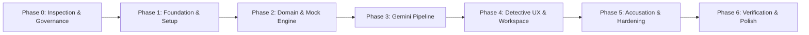

# Phases.md — Implementation Roadmap: AI Mystery Room

> **Execution Protocol:** Spec-driven, context-engineered delivery decomposed into 7 verifiable phases.

---

## Roadmap Overview

---

## Phase 0: Repository Inspection & Governance
- **Objective:** Finalize project specification, lock architecture, create mandatory GSD documentation, initialize git repository and work breakdown.
- **Tasks:**
  - [x] Task 0.1: Inspect repository, verify system environment (Node v22, npm v10).
  - [x] Task 0.2: Author mandatory GSD docs (`PRD.md`, `Architecture.md`, `Rules.md`, `Phases.md`, `Design.md`, `Memory.md`).
  - [x] Task 0.3: Setup `.gsd/SPEC.md`, `.gsd/ROADMAP.md`, `docs/SPEC.md`, `docs/DECISIONS.md`.
  - [x] Task 0.4: Commit Phase 0 governance baseline.
- **Verification:**
  - Clean git status with all documentation files in place.
- **Status:** Completed

---

## Phase 1: Monorepo Foundation & Tooling Setup
- **Objective:** Establish npm workspaces, TypeScript configurations, shared types package, Express API skeleton, and Vite React frontend skeleton.
- **Tasks:**
  - [x] Task 1.1: Initialize root `package.json` with npm workspaces (`apps/web`, `apps/api`, `packages/shared`).
  - [x] Task 1.2: Scaffold `packages/shared` with base constants, shared Zod schemas, and public DTO types.
  - [x] Task 1.3: Scaffold `apps/api` with Express, TypeScript, CORS, Zod env validation, `/api/v1/health` endpoint, and test harness.
  - [x] Task 1.4: Scaffold `apps/web` with Vite, React 18, TypeScript, Tailwind CSS, Lucide icons, and AppShell layout.
  - [x] Task 1.5: Setup Vitest in both packages and verify build commands (`npm run build`, `npm run test`).
- **Verification:**
  - `GET /api/v1/health` returns `200 OK` with JSON status.
  - `apps/web` builds cleanly with Tailwind styles applied.
  - `npm test` runs and passes across all packages (14 tests passed).
- **Status:** Completed

---

## Phase 2: Domain Modeling, Consistency Engine & Mock Case Generation
- **Objective:** Build Mongoose schemas, deterministic consistency validation, DTO sanitization, and a fully functional mock generator.
- **Tasks:**
  - [x] Task 2.1: Implement Mongoose `MysteryCase` schema with indexes, status transitions, and data integrity hooks.
  - [x] Task 2.2: Implement `MysteryConsistencyValidator` enforcing 2+ supporting clues, 1+ weakening clue, valid chronology, and unique IDs.
  - [x] Task 2.3: Implement `toPublicCaseDTO` and `toSolutionDTO` serializers strictly preventing secret leakage.
  - [x] Task 2.4: Implement mock case generation engine producing complete, solvable, high-fidelity detective cases offline.
  - [x] Task 2.5: Implement case CRUD API endpoints (`POST /cases`, `GET /cases/:id/status`, `GET /cases/:id`, `PATCH /cases/:id/player-state`, `GET /cases`, `DELETE /cases/:id`).
  - [x] Task 2.6: Supertest API integration suite validating lifecycle, guest session security, and no-leak assertions.
- **Verification:**
  - API tests verify creating, polling, retrieving, taking notes, and listing cases with zero leaked solution data.
- **Status:** Completed

---

## Phase 3: Gemini AI Generation Pipeline
- **Objective:** Integrate Google Gemini Gen AI SDK with multi-stage structured prompting (Outline → Evidence Plan → Evidence Synthesis → Consistency Verification).
- **Tasks:**
  - [x] Task 3.1: Implement `GeminiService` using `@google/genai` with model configuration (`GEMINI_MODEL`, `GEMINI_API_KEY`), timeout, and backoff retries.
  - [x] Task 3.2: Implement structured prompt templates for Outline Generation and Evidence Generation with strict Zod parsing.
  - [x] Task 3.3: Wire the generation pipeline coordinator with honest stage progression (`generating_outline`, `generating_evidence`, `validating`, `ready`).
  - [x] Task 3.4: Implement simulated evidence card asset service (rich SVG/HTML card generators for chat, camera logs, documents, and witness statements).
  - [x] Task 3.5: Add unit tests with mock Gemini fixtures testing schema parsing, malformed recovery, and consistency rejections.
- **Verification:**
  - Unit and mock integration tests prove end-to-end AI case generation and schema resilience (6 tests passed).
- **Status:** Completed

---

## Phase 4: Detective Investigation UI & Workspace
- **Objective:** Develop responsive, atmospheric detective workspace with case briefing, suspect roster, multi-format evidence viewer, and investigator notebook.
- **Tasks:**
  - [x] Task 4.1: Implement Detective Theme system (Tailwind tokens, fonts, audio-visual atmosphere, badge components).
  - [x] Task 4.2: Build Landing Page & Scenario Creation form with genre, difficulty, setting, and evidence selectors.
  - [x] Task 4.3: Build Generation Status view with radar/progress stages and cancel/back navigation.
  - [x] Task 4.4: Build Investigation Workspace (3-column desktop / tabbed mobile layout with briefing, suspects, evidence docket, timeline).
  - [x] Task 4.5: Build specialized Evidence Viewers (Fictional Chat Log, CCTV Camera Log, Police Report/Document, Witness Interview, Photo Clue).
  - [x] Task 4.6: Build interactive features: Star/flag important evidence, live investigator notebook with auto-save.
  - [x] Task 4.7: Build "My Cases" dashboard for resuming and managing ongoing cases.
- **Verification:**
  - Responsive visual inspection and interaction testing across desktop and mobile viewports (all 5 frontend tests passed, builds cleanly).
- **Status:** Completed

---

## Phase 5: Accusation Dialog, Reveal Screen & Security Hardening
- **Objective:** Deliver server-authoritative accusation submission, cited spoiler reveal, rate limiting, and security hardening.
- **Tasks:**
  - [x] Task 5.1: Build high-stakes Accusation Confirmation Dialog (confirming single-shot choice).
  - [x] Task 5.2: Implement `POST /api/v1/cases/:id/accusation` backend endpoint with atomic state transition to `completed`.
  - [x] Task 5.3: Build Evidence-Cited Reveal Screen (Culprit portrait, motive breakdown, method details, chronological master sequence, debunked red herrings).
  - [x] Task 5.4: Implement security headers (Helmet), input sanitization, rate limiting on case creation, and session-scoped access controls.
  - [x] Task 5.5: Write Supertest security tests verifying IDOR protection, accusation immutability, and rejection of non-owner actions.
- **Verification:**
  - Accusation accurately reveals cited solution only upon submission; duplicate submission is rejected; replay/review preserves solved state.
- **Status:** Completed

---

## Phase 6: Playwright E2E Verification & Production Readiness
- **Objective:** Verify full end-to-end player journeys in headless browser, audit accessibility, and produce complete production documentation.
- **Tasks:**
  - [x] Task 6.1: Write Playwright E2E test suite covering: Creation → Generation → Evidence Inspection → Note Taking → Accusation → Reveal.
  - [x] Task 6.2: Run Playwright tests and capture visual verification artifacts.
  - [x] Task 6.3: Audit WCAG 2.2 AA accessibility (keyboard navigation, ARIA attributes, color contrast).
  - [x] Task 6.4: Update `README.md` with complete setup instructions, architecture summary, environment variables, and run scripts.
  - [x] Task 6.5: Verify clean `npm run build`, `npm run lint`, and all test suites passing with zero errors.
- **Verification:**
  - Playwright test run reports 100% passing; all unit, integration, and E2E suites green.
- **Status:** Completed
